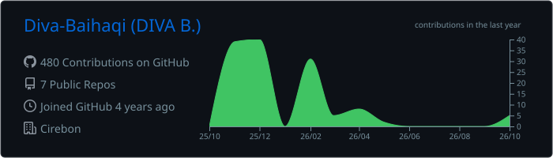
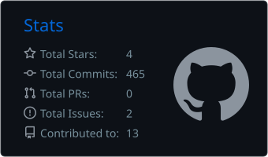
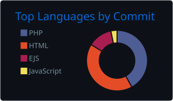

<!-- ==================== HEADER ==================== -->

 

 

<!-- ==================== ABOUT ME ==================== -->
##  Tentang Saya

Saya **Full Stack Developer** yang fokus di **PHP, Laravel**, dan teknologi web modern. Saya suka membangun aplikasi yang **efisien, scalable, dan ramah pengguna** untuk menyelesaikan masalah nyata.

- 🔭 Fokus: **Web Development & Cloud Computing**
- 🌱 Sedang belajar: **AI & Machine Learning, Mobile Development**
- 🤝 Minat: **Open Source, Komunitas Tech, Mentoring**
- 🐼 Fun fact: Panda lover, coffee addict ☕, dan chef di rumah 🍳

 

<!-- ==================== TECH STACK ==================== -->
##  Tech Stack

**Languages & Frameworks**

**Database & Cloud**

**Tools & Environment**

**Lainnya**

<!-- ==================== INTERESTS ==================== -->
##  Minat & Aktivitas

| 💡 Teknologi | 🎨 Kreativitas | 🎵 Rekreasi | 🌍 Sosial |
| :-: | :-: | :-: | :-: |
| AI & ML | Fotografi | Memasak | Komunitas Tech |
| Web Dev | Desain Grafis | Musik | Mentoring |
| Mobile Apps | Menulis | Film | Networking |

<!-- ==================== GITHUB STATS ==================== -->
##  GitHub Analytics

<!-- ==================== CONTRIBUTION CHART ==================== -->
##  Contribution Chart

<!-- ==================== TROPHIES ==================== -->
##  GitHub Trophies

<!-- ==================== SNAKE ==================== -->
##  Contribution Snake

<picture>
  <source media="(prefers-color-scheme: dark)" srcset="https://raw.githubusercontent.com/Diva-Baihaqi/Diva-Baihaqi/output/github-snake-dark.svg" />
  <source media="(prefers-color-scheme: light)" srcset="https://raw.githubusercontent.com/Diva-Baihaqi/Diva-Baihaqi/output/github-snake.svg" />
  
</picture>

<!-- ==================== CONNECT ==================== -->
##  Let's Connect!

<!-- ==================== FOOTER ==================== -->

 

**Terima kasih sudah berkunjung! Have a nice day!** 🐼

